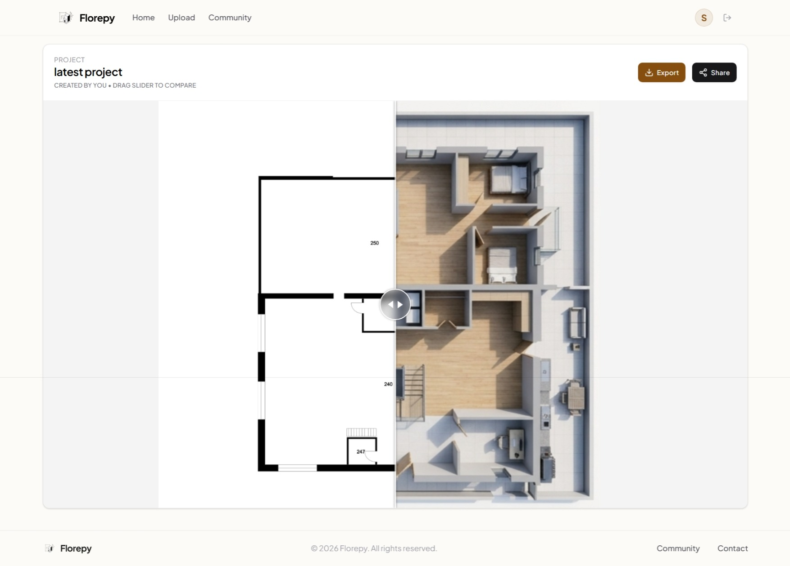

# Florepy

> Transform 2D floor plans into photorealistic 3D architectural visualizations with AI.



Florepy is an AI-powered architectural visualization platform that turns flat 2D floor plans into immersive, photorealistic 3D renderings in seconds. Upload any plan, preview transformations with an interactive before/after slider, collaborate with clients using spatial review pins, and manage projects in the cloud.


## Key Features

* **2D to 3D AI Transformation** – Convert architectural floor plans (JPG, PNG, WebP, SVG) into top-down, photorealistic 3D models using AI inference.
* **Interactive Comparison Slider** – Inspect structural details side-by-side with a smooth, interactive before/after overlay slider.
* **Client Review & Spatial Feedback Pins** – Share secure client review links with optional passcode protection. Clients can drop spatial comment pins directly on designs, while owners manage and resolve feedback.
* **Responsive Pin Positioning** – Dynamic letterbox and aspect-ratio detection locks review pins to precise image coordinates across all screen resolutions and window resizes.
* **Client-Side Preprocessing** – In-browser vector (SVG) rasterization on an HTML5 canvas to guarantee high-contrast, AI-ready inputs.
* **Puter Cloud Ecosystem** – Built-in authentication, decentralized cloud file storage (`puter.fs`), key-value state (`puter.kv`), and static hosting via Puter.js.
* **Serverless Worker Architecture** – Dedicated Puter Worker (`lib/puter.worker.js`) orchestrating project state, client review indices, and community feed caching.
* **Community Feed & Dashboard** – Discover creations from the community showcase or manage private architectural renders in your personal workspace.


## Technology Stack

* **Framework:** React Router v7 (Full-Stack SSR / CSR)
* **Frontend:** React 19, TypeScript
* **Styling:** Tailwind CSS v4
* **Cloud & Auth:** Puter.js (Auth, File System, KV Store, Hosting, Workers)
* **Icons & UI:** Lucide React, React Compare Slider
* **Bundler:** Vite 8


## Quickstart Guide

### Prerequisites

* Node.js (v20.x or higher)
* npm (v10.x or higher)

### 1. Clone & Install

```bash
git clone https://github.com/Abheeshta-P/Florepy.git
cd Florepy
npm install
```

### 2. Environment Setup

Create a `.env` file in the project root:

```env
VITE_PUTER_WORKER_URL=https://your-puter-worker.puter.site
```

### 3. Run Locally

Start the Vite development server with HMR:

```bash
npm run dev
```

Visit `http://localhost:5173` in your browser.


## Build & Production

```bash
# Type check the codebase
npm run typecheck

# Build for production
npm run build

# Start the production server
npm run start
```


## Project Structure

```text
florepy/
├── app/
│   ├── routes/
│   │   ├── home.tsx              # Landing page, community showcase & upload interface
│   │   ├── dashboard.tsx         # User workspace & project management
│   │   └── visualizer.$id.tsx    # 3D visualization workspace, comparison slider & client review
│   ├── app.css                   # Global styles & Tailwind CSS v4 directives
│   ├── root.tsx                  # Document shell, root layout & Puter auth context
│   └── routes.ts                 # React Router route definitions
├── components/
│   ├── ui/                       # Reusable UI primitives (Button, Modal, Pill, etc.)
│   ├── AuthProvider.tsx          # Authentication context & session lifecycle
│   ├── NavBar.tsx                # Header navigation & Puter sign-in
│   └── Upload.tsx                # Drag-and-drop dropzone & SVG rasterizer
├── lib/
│   ├── ai.action.ts              # AI model integration & prompt orchestration
│   ├── constants.ts              # System constraints & validation logic
│   ├── puter.action.ts           # Puter auth, project CRUD & client review operations
│   ├── puter.hosting.ts          # Static project hosting helpers & asset publication
│   ├── puter.worker.js           # Puter Worker router (project vault, review store & feed)
│   └── utils.ts                  # File utilities, clipboard helpers & binary conversion
├── public/                       # Static assets & demo previews
└── package.json
```


Developed and maintained by [Abheeshta P](https://github.com/Abheeshta-P).
