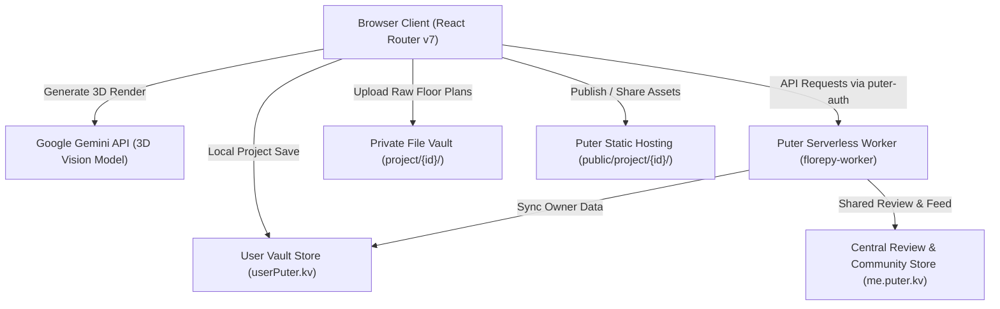

# Florepy System Architecture Documentation

This document describes the architectural design, storage models, and data synchronization workflows of Florepy.



## 1. System Topology Overview

Florepy is structured across four primary layers:
1. Frontend Layer: Built with React Router v7, React 19, TypeScript, and Tailwind CSS. Runs in the user browser and executes client-side SVG rasterization on HTML5 canvas and aspect-ratio coordinate normalization.
2. AI Inference Layer: Direct programmatic calls to Google Gemini API (gemini-3.1-flash-image-preview) to transform 2D architectural drawings into photorealistic 3D visualizations.
3. Serverless Backend Layer: A lightweight Puter Worker router (lib/puter.worker.js) deployed as a microservice on Puter.site. Handles authentication verification, project persistence, review mutations, and community feeds.
4. Storage & Hosting Layer: Puter.js decentralized cloud ecosystem including user-scoped Key-Value storage, private cloud filesystem (puter.fs), and subdomain static hosting.

## 2. Key-Value Storage Architecture

Puter KV does not employ relational SQL tables (no CREATE TABLE statements) or document collections. The entire storage mechanism is a single flat key-value dictionary.

Virtual tables are constructed using explicit namespace prefixes:

| Namespace Prefix | Scope | Virtual Table Purpose | Access Level |
| | | | |
| florepy_project_ | userPuter.kv | Owner Master Projects | Authenticated owner only |
| florepy_review_ | me.puter.kv | Client Review Sessions | Owner and invited clients holding token |
| florepy_community_ | me.puter.kv | Public Showcase Registry | Publicly accessible to any user or guest |

### The Two KV Contexts
1. User KV Context (userPuter.kv):
   Bound directly to the authenticated user Puter account. Used for personal project storage. External visitors and unauthenticated clients cannot read or write to this space.
2. Worker KV Context (me.puter.kv):
   Bound to the serverless application itself. Acts as the central shared database for multi-user collaboration (client review pins) and the global community feed.

## 3. Data Schemas

### Owner Project Record: florepy_project_${id}
Stored in userPuter.kv.

```json
{
  "id": "1720010000000",
  "name": "Residence 1720010000000",
  "sourceImage": "project/1720010000000/source.png",
  "renderedImage": "project/1720010000000/rendered.png",
  "timestamp": 1720010000000,
  "ownerId": "uuid-user-1234",
  "ownerName": "Architect Name",
  "isPublic": false,
  "reviewToken": "rev_m3k9a1_8f4x2e",
  "reviewPasscode": "4821",
  "reviews": [
    {
      "id": "rev_1720010500_abcd",
      "x": 42.5,
      "y": 68.1,
      "author": "Client Name",
      "text": "Change living room flooring to oak.",
      "createdAt": 1720010500000,
      "resolved": false
    }
  ],
  "updatedAt": "2026-11-18T16:00:00.000Z"
}
```

### Shared Client Review Record: florepy_review_${id}
Stored in me.puter.kv.

```json
{
  "id": "1720010000000",
  "ownerId": "uuid-user-1234",
  "ownerName": "Architect Name",
  "name": "Residence 1720010000000",
  "sourceImage": "https://subdomain.puter.site/project/1720010000000/source.png",
  "renderedImage": "https://subdomain.puter.site/project/1720010000000/rendered.png",
  "timestamp": 1720010000000,
  "reviewToken": "rev_m3k9a1_8f4x2e",
  "reviewPasscode": "4821",
  "reviews": [
    {
      "id": "rev_1720010500_abcd",
      "x": 42.5,
      "y": 68.1,
      "author": "Client Name",
      "text": "Change living room flooring to oak.",
      "createdAt": 1720010500000,
      "resolved": false
    }
  ]
}
```

### Public Community Record: florepy_community_${id}
Stored in me.puter.kv.

```json
{
  "id": "1720010000000",
  "name": "Residence 1720010000000",
  "ownerId": "uuid-user-1234",
  "ownerName": "Architect Name",
  "sourceImage": "https://subdomain.puter.site/project/1720010000000/source.png",
  "renderedImage": "https://subdomain.puter.site/project/1720010000000/rendered.png",
  "isPublic": true,
  "timestamp": 1720010000000,
  "updatedAt": "2026-11-18T16:00:00.000Z"
}
```

## 4. Private Vault vs Public Static Hosting

Puter enforces strict access isolation on user cloud storage:
- Private Vault (project/{id}/): Files written here are accessible only by the authenticated owner account. Direct HTTP links to private paths return 403 Forbidden to outside requests.
- Public Hosting (public/project/{id}/): Mounted to the owner Puter subdomain (https://subdomain.puter.site). Files copied here are served over HTTPS publicly.

When an owner publishes a project to the Community showcase or generates a Client Review link, Florepy replicates the private assets into the public hosting tree:
- Private Source: project/{id}/source.png -> Public Copy: public/project/{id}/source.png
- Private Render: project/{id}/rendered.png -> Public Copy: public/project/{id}/rendered.png

This ensures external clients can view the design without compromising the owner account credentials.

## 5. Client Review Engine and Spatial Pin Math

### Review Token Generation
When the project owner requests a review link, Florepy generates an unguessable token:

```typescript
const token = `rev_${Date.now().toString(36)}_${Math.random().toString(36).substring(2, 8)}`;
```
Components:
- Prefix: rev_
- Base36 Timestamp: Date.now().toString(36)
- Random Entropy: Math.random().toString(36).substring(2, 8)

### Coordinate-Anchored Pin Positioning
Pins are not placed relative to the viewport or letterbox padding. They are anchored strictly to image coordinates (0% to 100% of the active floor plan / render).

To guarantee coordinate stability across screen sizes, the engine calculates the rendered dimensions of the image inside the container:

```typescript
const naturalW = imageNaturalSize.width || 1024;
const naturalH = imageNaturalSize.height || 1024;
const imgAspect = naturalW / naturalH;
const containerAspect = containerWidth / containerHeight;

let renderedW = containerWidth;
let renderedH = containerHeight;
let left = 0;
let top = 0;

if (containerAspect > imgAspect) {
  renderedH = containerHeight;
  renderedW = containerHeight * imgAspect;
  left = (containerWidth - renderedW) / 2;
  top = 0;
} else {
  renderedW = containerWidth;
  renderedH = containerWidth / imgAspect;
  left = 0;
  top = (containerHeight - renderedH) / 2;
}
```

The resulting bounding box (imageBounds) informs both click coordinate translation and pin placement:
- Click translation: x = ((clickX - bounds.left) / bounds.width) * 100
- Pin rendering: pinLeft = bounds.left + (pin.x / 100) * bounds.width

A ResizeObserver continuously monitors container dimensions to update bounds and reposition pins dynamically on window resize.

## 6. Worker REST API Endpoints

All endpoints are hosted on the Puter Worker microservice:

| Endpoint | Method | Auth Required | Functionality |
| | | | |
| /api/projects/save | POST | Yes (userPuter) | Persists project metadata, merges existing KV state, and syncs image paths. |
| /api/projects/list | GET | Yes (userPuter) | Scans florepy_project_* in user KV and aggregates review counts for Dashboard. |
| /api/projects/get | GET | Conditional | Retrieves project by ID. Checks owner vault first, then token-gated review store, then community store. |
| /api/projects/community | GET | No | Scans florepy_community_* in worker KV and returns sorted public showcase items. |
| /api/projects/review | POST | Token / Owner | Processes review actions (add, resolve, edit, delete, sync) with strict role checks. |
| /api/projects/delete | POST | Yes (userPuter) | Deletes project from owner KV, worker review store, public community store, and Puter FS. |

## 7. Review Mutation Authority in /api/projects/review

Review mutations are processed through explicit action strings:
- add: Allowed for verified client (matching reviewToken) or owner. Creates review pin.
- resolve: Allowed strictly for the project owner. Toggles resolution state.
- delete: Allowed for comment author, or for owner only if the comment is resolved.
- edit: Allowed strictly for comment author. Owners cannot edit client feedback.
- sync: Allowed strictly for project owner. Syncs reviewToken, reviewPasscode, or asset paths.

Once modified, the worker saves the updated review record to me.puter.kv under florepy_review_${projectId}. If the caller is the authenticated owner, it simultaneously mirrors the changes to the owner personal KV store under florepy_project_${projectId}.
