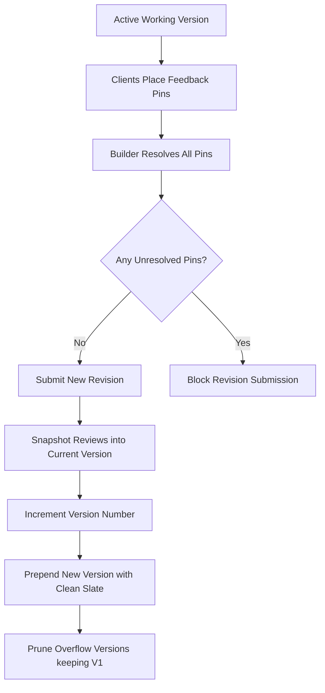

# Project Versioning and Reviews Architecture

This document provides a detailed technical reference for the Florepy revision management and collaborative feedback system. It explains the underlying data models, field purposes, version pruning mechanics, and permission guardrails.


## 1. Field Reference: `targetVer.reviews` vs `reviewRecord.reviews`

In the Puter KV store, project records contain both a top-level `reviews` array and individual `reviews` arrays nested inside each version object.

### Structural Overview

```json
{
  "id": "1730000000000",
  "name": "Hillside Residence",
  "activeVersionId": "ver_1730002000_v2",

  "reviews": [ ... ],

  "versions": [
    {
      "id": "ver_1730002000_v2",
      "versionNumber": 2,
      "name": "Version 2",
      "sourceImage": "https://florepy.puter.site/...",
      "renderedImage": "https://florepy.puter.site/...",
      "reviews": [ ... ]
    },
    {
      "id": "ver_1730001000_v1",
      "versionNumber": 1,
      "name": "Version 1",
      "sourceImage": "project/1730000000000/source.png",
      "renderedImage": "project/1730000000000/rendered.png",
      "reviews": [ ... ]
    }
  ]
}
```

### Comparison Matrix

| Field | Location | Primary Purpose | Lifecycle Behavior |
| --- | --- | --- | --- |
| **`targetVer.reviews`** | `reviewRecord.versions[i].reviews` | **Historical record** of feedback belonging strictly to that specific version. | Frozen when a new version is created. Retains all resolved comments for historical audit and comparison. |
| **`reviewRecord.reviews`** | Root object (`reviewRecord.reviews` / `project.reviews`) | **Active display mirror** for UI canvas rendering and legacy compatibility. | Synchronized with the active working version. When switching views, it reflects the selected version's pins on screen. |

### Why Both Exist

1. **Canvas Component Rendering**: The frontend canvas component renders pins directly from `project.reviews`. Mirroring the active version's review list to `project.reviews` provides immediate rendering without querying the `versions` array repeatedly during interactive drag/zoom cycles.
2. **Backward Compatibility**: Projects created prior to the introduction of versioning lack a `versions` array. Maintaining `project.reviews` at the root guarantees unversioned projects continue to load and render pins without errors.
3. **Safe Synchronization Rule**: In `POST /api/reviews`, the worker updates `targetVer.reviews` for the specific revision, but only updates `reviewRecord.reviews` if `targetVer.id === reviewRecord.activeVersionId`. Operating on any historical version never overwrites or corrupts the active project state.


## 2. Complete Versioning Schema Reference

### Root Project Properties

- **`activeVersionId`** (`string | null`): Identifier of the version currently selected by the builder. Determines which floor plan, 3D render, and review pins are loaded into the visualizer workspace.
- **`maxVersions`** (`number`, default: 5, max: 20): Maximum number of revisions retained in storage before automated pruning triggers.
- **`retentionDays`** (`number`, default: 30): Configurable retention window for version history.
- **`versions`** (`ProjectVersion[]`): Descending array of version entries sorted newest first (`versionNumber` descending).

### Version Object Properties (`ProjectVersion`)

- **`id`** (`string`): Unique identifier (e.g. `ver_<timestamp>_<random>`).
- **`versionNumber`** (`number`): Sequential version index (Version 1, Version 2, etc.).
- **`name`** (`string`): User-assigned label or default formatted name (e.g. "Version 2 - Open Concept Kitchen").
- **`sourceImage`** (`string`): Storage path or hosted URL of the 2D floor plan drawing for this revision.
- **`renderedImage`** (`string | null`): Storage path or hosted URL of the AI-generated 3D visualization.
- **`timestamp`** (`number`): Unix millisecond timestamp when the revision was finalized.
- **`createdAt`** (`string`): ISO 8601 string representation of revision creation time.
- **`reviews`** (`ProjectReview[]`): Array of review pins placed on this specific version.


## 3. Version Lifecycle Mechanics



### The Revision Pipeline

1. **Resolution Guardrail**: Before a new revision can be created, all review pins on the current active version must have `resolved: true`. Unresolved comments abort the submission with HTTP 400.
2. **Review Snapshotting**: Existing comments are retained inside `currentActiveVer.reviews` so that past conversations remain accessible when inspecting earlier iterations.
3. **Iteration Initialization**:
   - Computes `nextNum = highestExistingVersionNumber + 1`.
   - Uploads new floor plan drawing and optional AI 3D render to Puter hosting.
   - Creates the new version object with an empty `reviews: []` array (fresh discussion slate).
   - Sets the new version as `activeVersionId` and prepends it to `versions[0]`.


## 4. Automated Version Pruning and Retention

Pruning enforces storage constraints and clean project history by auto-deleting intermediate revisions according to two rules:
1. **Inactivity Expiration**: In-between intermediate revisions that have been inactive for more than `retentionDays` (default 30 days) are auto-deleted.
2. **Capacity Capping**: If the number of surviving revisions still exceeds `maxVersions` (default: 5), the oldest intermediate revisions are pruned to maintain the cap.

### Retention Invariant: Version 1 and Active Version Protection

- **Version 1** is the initial baseline layout of the project and is **never auto-deleted**.
- **Active Working Version** and **Latest Version** are currently worked on and are **never auto-deleted**.

Why Version 1 is permanently retained:
1. **Design Baseline Comparison**: In architectural visualization, users frequently compare advanced iterations (e.g. Version 6) back to the original starting layout.
2. **Root Asset Reference**: Version 1 directly anchors the initial uploaded assets (`project/<id>/source.png` and `project/<id>/rendered.png`). Preserving Version 1 keeps project identity coherent.

### Pruning Algorithm

```javascript
function pruneVersions(
  versions,
  activeVersionId,
  maxVersions = DEFAULT_MAX_VERSIONS,
  retentionDays = DEFAULT_RETENTION_DAYS
) {
  if (!Array.isArray(versions) || versions.length === 0) return versions || [];

  const now = Date.now();
  const maxAgeMs = retentionDays * 24 * 60 * 60 * 1000;

  // Sort descending: newest first
  const sorted = [...versions].sort(
    (a, b) => (b.versionNumber || 0) - (a.versionNumber || 0)
  );

  const v1 = sorted.find((v) => v.versionNumber === 1);
  const latest = sorted[0];
  const active = sorted.find((v) => v.id === activeVersionId) || latest;

  // In-between versions (neither Version 1, nor latest, nor currently active)
  const intermediates = sorted.filter(
    (v) => v.versionNumber !== 1 && v.id !== active.id && v.id !== latest.id
  );

  // 1. Auto-delete intermediate versions that have been inactive for > retentionDays
  const activeIntermediates = intermediates.filter(
    (v) => now - (v.timestamp || 0) <= maxAgeMs
  );

  // 2. Identify all protected versions (unique set of V1, latest, active)
  const protectedVersions = Array.from(new Set([v1, latest, active].filter(Boolean)));

  // 3. Cap total versions to maxVersions by selecting the newest surviving intermediate versions
  const allowedIntermediates = Math.max(0, maxVersions - protectedVersions.length);
  const cappedIntermediates = activeIntermediates.slice(0, allowedIntermediates);

  return Array.from(new Set([...protectedVersions, ...cappedIntermediates])).sort(
    (a, b) => (b.versionNumber || 0) - (a.versionNumber || 0)
  );
}
```


## 5. Review Permissions and Security Rules

### Historical Versions Are Read-Only

Previous versions serve as audit records and cannot receive new comments:
- **Client Review Isolation**: When clients access a project via secret review token (`?review=<token>`), the server returns `versions: undefined` and serves only `versions[0]`. Clients cannot switch to past versions.
- **Backend Guard**: In `POST /api/reviews`, any request attempting `action: "add"` that targets a version other than `versions[0]` is rejected with HTTP 400 (`"Reviews can only be added to the latest version of the project"`).
- **Frontend Guard**: In the visualizer, `canAddReview` is evaluated as `isClientReviewMode && isLatestVersion`. The review button and pin placement interactions are disabled when viewing earlier versions.


## 6. Backward Compatibility Handling

All backward-compatibility logic is annotated in the codebase with:
`// Note: for backward compatibility`

1. **Legacy Project Promotion**: In `POST /api/projects/version`, if a project is loaded that does not have a `versions` array, its root assets and reviews are wrapped into a synthetic Version 1 entry before applying revision operations.
2. **Missing Versions Fallback**: In `GET /api/projects/get` and `POST /api/reviews`, calls safely fall back to `reviewRecord.reviews` and `reviewRecord.sourceImage` if `versions` is empty or undefined.
